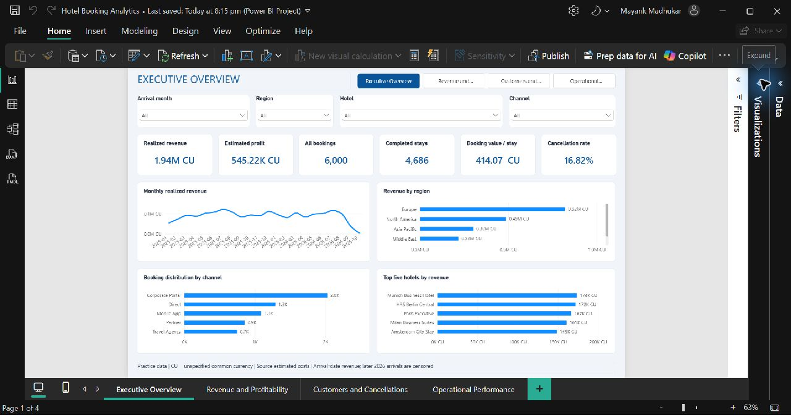
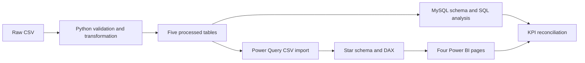

# Hotel Booking Analytics

A hotel reservation analysis using MySQL, Python and Power BI. The project examines revenue, estimated profitability, cancellations and booking demand across 6,000 practice bookings.



## Start here

- **Open the dashboard:** [Hotel Booking Analytics.pbix](powerbi/Hotel%20Booking%20Analytics.pbix)
- **Understand the findings:** [Business insights](reports/business_insights.md)
- **Walk through the project:** [Interview guide](docs/INTERVIEW_GUIDE.md)
- **Inspect the editable report:** [Power BI source project](powerbi/source/Hotel%20Booking%20Analytics.pbip)

The PBIX contains imported data and can be opened without a running database. For CSV refresh on another computer, change `pDataFolder` in **Transform data > Edit parameters** to the local `data/processed` folder.

## Business questions

- Which regions and hotels contribute most to revenue and estimated profit?
- How do cancellation rates and completed-stay booking values differ by channel?
- Which booking-level customer segments generate the most value?
- What do arrival patterns and lead times suggest for operational planning?

## Dataset

The included source is a hotel booking practice CSV. Its original publisher and currency are unverified; results are not actual company performance. Monetary values are labeled **CU**, assuming a common source currency unit.

| Attribute | Coverage |
|---|---|
|Booking grain|One reservation per row; one room per booking assumed|
|Records|6,000 bookings, 799 customer IDs, 21 hotels|
|Dimensions|Five regions, five channels, four booking-level customer segments|
|Booking dates|January 2025 through August 2026|
|Statuses|4,686 Completed; 1,009 Cancelled; 305 No Show|

The original file is preserved in [data/raw/bookings_source.csv](data/raw/bookings_source.csv). Its SHA-256 is recorded in [data_quality.json](reports/data_quality.json).

Two source inconsistencies affect the model. Customer IDs span multiple segments, so segment remains on the booking fact. Hotels span multiple country labels, so source_country is retained as an ambiguous booking attribute. Hotel location/category, guest counts, commissions and customer registration dates are not invented.

## Workflow



The delivered Power BI report reads the processed CSVs. MySQL is a parallel relational analysis and validation branch, rather than the report's current live connection.

Python checks IDs, required references, dates, nights, lead times, statuses and financial calculations. Invalid core records stop the refresh and are reported; rows are never silently discarded. Money is also represented in integer cents for exact financial checks. Five processed CSVs provide bookings, hotels, customers, channels and dates.

## Data model and metrics

FactBookings connects to DimHotels, DimCustomers, DimChannels and DimDate through one-to-many relationships. Arrival date is the active date role; booking and checkout dates are inactive roles. Booking Demand switches to booking date to count reservation creation rather than arrivals.

| Metric | Definition |
|---|---|
|Total Bookings|Distinct booking IDs across all statuses|
|Completed Bookings|Completed stays only|
|Revenue|Realized discounted room revenue|
|Estimated Profit|Revenue less source estimated costs|
|Average Booking Value|Revenue / completed bookings|
|Cancellation Rate|Cancelled / all bookings; No Show remains separate|
|Profit Margin|Estimated profit / revenue|
|Average Daily Rate|Realized room revenue / completed room nights|
|Average Length of Stay|Completed nights / completed bookings|
|Repeat Customer Rate|Customers with multiple completed stays / completed customers within the selection|

Noncompleted bookings have zero realized revenue and cost under the current contract. Zero denominators return null/blank. Revenue is attributed to arrival month rather than allocated across stay nights. Occupancy and RevPAR are excluded because room inventory is unavailable.

See the [model contract](powerbi/data_model.md), [KPI dictionary](powerbi/kpi_dictionary.md) and [DAX measures](powerbi/dax_measures.dax) for details.

## SQL analysis

Eight ordered SQL files cover schema creation, loading guidance, quality checks, 20 business questions, analytics views and independent KPI validation. The queries use joins, CTEs, subqueries, HAVING, CASE, ranking and LAG.

For example, this identifies the second distinct hotel revenue level, including ties:

```sql
WITH totals AS (
    SELECT hotel_id, SUM(revenue) AS revenue
    FROM bookings
    GROUP BY hotel_id
), ranked AS (
    SELECT *, DENSE_RANK() OVER (ORDER BY revenue DESC) AS revenue_rank
    FROM totals
)
SELECT h.hotel_name, r.revenue
FROM ranked r
JOIN hotels h USING (hotel_id)
WHERE revenue_rank = 2;
```

## Power BI report

| Page | Main analysis |
|---|---|
|Executive Overview|Bookings, revenue, profit, cancellations, region/channel contribution and leading hotels|
|Revenue and Profitability|Revenue/profit trends, margin, hotel contributions, channel ABV and period comparisons|
|Customers and Cancellations|Segment revenue, repeat customers, stay length and cancellation patterns|
|Operational Performance|Booking-date demand, lead times, regional ADR, room types and arrival seasonality|

The native report contains 23 DAX measures and synchronized month, region, hotel and channel slicers. Select one arrival month for prior-month/year comparisons. Use bottom tabs or Ctrl+click the header navigator in Desktop edit mode. Detail visuals can scroll.

Actual Desktop captures: [profitability](screenshots/powerbi_revenue_profitability.jpg), [customers](screenshots/powerbi_customer_cancellation.jpg), [operations](screenshots/powerbi_operational_performance.jpg).

The PBIX is the dashboard to open for presentation. The `powerbi/source` folder contains the PBIP, TMDL and PBIR files for inspecting and editing the report. These are source files, not duplicate dashboard copies. The theme and full Power Query definitions are embedded in that source; separate copies are unnecessary. The [interview guide](docs/INTERVIEW_GUIDE.md) explains the implementation.

## Results

| Finding | Calculated result |
|---|---:|
|Realized revenue|1,940,329.12 CU|
|Estimated profit|545,217.39 CU|
|Profit margin|28.10%|
|Cancellation rate|16.82%|
|Completed-stay average booking value|414.07 CU|
|Realized daily rate|137.04 CU|

Europe leads source-region revenue at 821,688.54 CU. Corporate Portal has the highest observed cancellation rate: 369 of 2,026 bookings, or 18.21%. Munich Business Hotel contributes the most estimated profit at 48,600.03 CU.

These are descriptive practice-data findings. Channel differences do not establish causation. Review lead time, customer mix and policy before changing channel spending; acquisition ROI cannot be calculated without commission and acquisition-cost data. Later 2026 arrivals are censored because booking history ends in August.

## Run the project

Use Python 3.12. From the repository root:

```powershell
python -m venv .venv
.\.venv\Scripts\python.exe -m pip install -r requirements.lock.txt
.\.venv\Scripts\python.exe python/pipeline.py
.\.venv\Scripts\python.exe python/run_tests.py
```

On macOS/Linux use `.venv/bin/python`. The pipeline rebuilds processed CSVs and reports from the included raw source. It does not synthesize replacement records. To update the dashboard afterward, select **Refresh** in Power BI Desktop.

### Optional MySQL refresh

Copy `.env.example` to `.env` and set credentials locally, or use environment variables. Then run:

```powershell
.\.venv\Scripts\python.exe python/pipeline.py --mysql
```

The loader creates `hotel_booking_analytics`, applies the schema, transactionally replaces this project's five tables, and creates the analytics views. It requires database/table/view creation and data access permissions. The refresh replaces the dedicated project's data; do not use it for unrelated tables. Credentials are never committed.

SQL execution order is 01-03, Python data loading, 04-06, 07, then 08. The loader automates 01-03, inserts the data and creates 07. Execute 04-06 and 08 afterward in MySQL Workbench when demonstrating the analysis.

## Verification

- Ten Python tests pass: keys, referential integrity, dates, money, known-answer KPIs, zero denominators, filtered reconciliation, reproducibility and deliberate corruption checks.
- Thirteen core quality checks pass with no records removed; missing reference attributes remain documented limitations.
- Real MySQL 8.0.44 verified the schema, loader, 20 business queries, monthly growth, independent KPI calculations and four constraint rejection cases.
- Eleven actual Desktop-exported KPIs match Python and the stored verified MySQL baseline.
- A July 2026 filter check produced 329 bookings and 115,995.16 CU revenue. Selecting Direct produced 73 bookings and 25,580.18 CU.

Evidence: [test output](reports/test_results.txt), [quality report](reports/data_quality_report.md), [MySQL results](reports/mysql_integration.json), [Power BI reconciliation](reports/powerbi_mysql_reconciliation.json) and [Desktop verification](reports/powerbi_verification.md).

The temporary MySQL instances were shut down and their server directories removed after testing. `python/verify_mysql_local.py` can create a new isolated instance if a local mysqld executable is available. The finished report is maintained through Power BI Desktop and its editable PBIP source; one-time report-generation helpers and downloaded schema caches are omitted from this portfolio.

## Repository structure

```text
Hotel-Booking-Analytics/
├── data/          # Preserved source and five processed tables
├── docs/          # Interview walkthrough
├── powerbi/       # Finished PBIX, readable DAX/KPI notes and editable source/
├── python/        # Data pipeline, analysis, validation and database loading
├── reports/       # Findings, evidence, quality reports and resume summary
├── screenshots/   # Actual Desktop captures and Python figure
├── sql/           # Ordered MySQL scripts
├── tests/         # Automated data and KPI tests
├── .env.example
├── requirements.txt
├── requirements.lock.txt
└── README.md
```

## Limitations and next steps

Verify source currency and geography, obtain customer/hotel references and channel costs, and add room inventory before capacity metrics. Profit uses source cost estimates. A refund cash ledger and night-level revenue recognition would require additional data and rules. Power BI Service publication and scheduled refresh are not configured. More complete history is needed for defensible seasonal forecasting.
